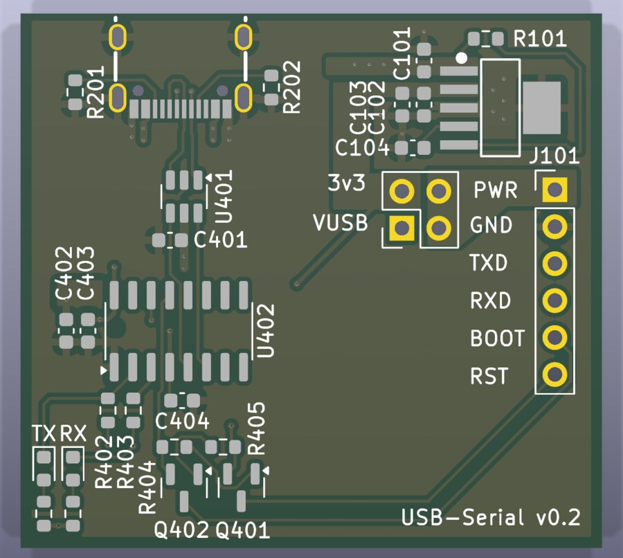
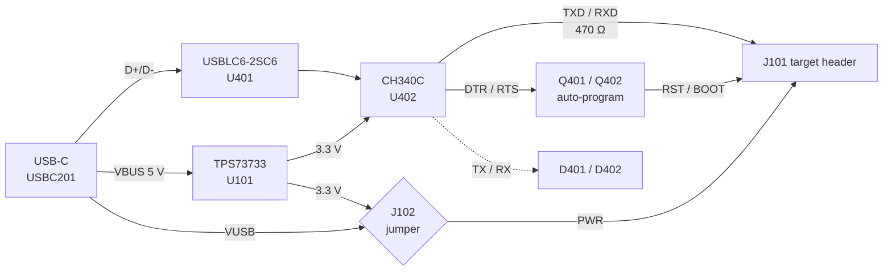

# USB Serial Flasher

A USB-C to 3.3 V UART adapter for programming and talking to ESP32 / ESP8266
boards. It uses a WCH CH340C USB-UART bridge, the standard Espressif two-transistor
auto-program circuit (so `esptool` can reset the target into the bootloader on its
own), a jumper-selectable 5 V / 3.3 V supply for the target, and TX/RX activity LEDs.



| | |
|---|---|
| Board | 40.0 × 36.75 mm, 4 layers (In1 = GND plane, In2 = VUSB plane), 1.6 mm |
| Host side | USB-C receptacle, USB 2.0 full speed (12 Mbit/s), bus powered |
| Target side | 6-pin 2.54 mm header: PWR, GND, TXD, RXD, BOOT, RST |
| Logic level | 3.3 V on TXD/RXD (CH340C runs from 3.3 V) |
| Target supply | 5 V (VUSB) or 3.3 V (TPS73733 LDO, 1 A part), or none |
| Baud rate | Up to 2 Mbaud (CH340C); `esptool` at 921600 is fine |
| Revision | v0.2 (see [Revision history](#revision-history)) |

## Block diagram



## Connectors

### J101 — target header (1×6, 2.54 mm)

J101 is marked DNP, so JLCPCB does not fit it. Solder a straight or right-angle
header, or wire a cable directly.

| Pin | Name | Direction | Connect to on the target |
|---|---|---|---|
| 1 | PWR | out | 5 V or 3.3 V input, depending on J102 (leave J102 open if the target has its own supply) |
| 2 | GND | — | GND |
| 3 | TXD | out | Target **RX** (U0RXD). CH340C TXD through 470 Ω |
| 4 | RXD | in | Target **TX** (U0TXD). Reaches the CH340C RXD through 470 Ω |
| 5 | BOOT | open collector | GPIO0 / IO0 (or the strapping pin that selects download mode) |
| 6 | RST | open collector | EN / CHIP_PU / RST |

BOOT and RST only ever pull low. The target must provide its own pull-ups
(and the usual RC on EN). Every ESP32 module design already does.

### J102 — target supply select (2×2, 2.54 mm)

Viewed with the USB-C connector at the top, as in the render above:

```
          left    right
  top   [ 3v3 ] [ PWR ]     jumper across the top row    -> PWR = 3.3 V
 bottom [VUSB ] [ PWR ]     jumper across the bottom row -> PWR = 5 V
                            no jumper                    -> PWR not driven
```

> **Never place the jumper vertically on the left column** (VUSB to 3v3).
> That shorts 5 V onto the 3.3 V rail. The CH340C (V3 tied to VCC) would then
> see 5 V, and the LDO output would be driven backwards. See review item R1.

## How the circuit works

### USB-C input — sheet `usb_serial`

* **USBC201** (HRO TYPE-C-31-M-12) is a 16-pin USB 2.0 receptacle. The two D+ and
  two D− contacts are tied together, so the cable works in either orientation.
* **R201 / R202** (5.1 kΩ to GND on CC1/CC2) are the Rd pull-downs that identify
  the board as a sink, so a C-to-C cable delivers VBUS. Without them a USB-C charger
  or laptop leaves VBUS off.
* **U401** (USBLC6-2SC6) is a low-capacitance TVS array that clamps ESD on D+/D− and
  VBUS. It is placed between the connector and the CH340C (flow-through pins 1→6
  and 3→4).
* **Shield.** The four shell tabs are tied to GND (new in v0.2), giving ESD
  striking the shell a direct path to the ground plane.
* **C401 / C402** (100 nF + 10 µF) decouple VBUS at the connector.
  Together with C101 that is 11.1 µF nominal. With 0603 X5R DC-bias derating at 5 V
  the effective value stays under the USB 2.0 10 µF inrush limit.

### 3.3 V regulator — root sheet

* **U101** (TI TPS73733DCQ, SOT-223-6) is a fixed 3.3 V, 1 A LDO fed from VUSB.
  It powers the CH340C and, through J102, optionally the target.
* **R101** (10 kΩ) pulls EN up to VUSB, so the regulator is always on.
* **C104** (10 nF) on NR is the noise-reduction cap for the fixed-output version.
* **C101** (input) and **C102 / C103** (output) are 1 µF ceramics. C102's ground now
  has a direct trace to U101 pin 3 (v0.2).
* **Dissipation.** At 5 V in, every 100 mA drawn from 3.3 V costs about 0.17 W in
  U101. A Wi-Fi-active ESP32 averaging 150–250 mA is about 0.25–0.4 W, which is fine
  for the SOT-223 on this copper. Expect it to get warm during transmit bursts.
  Total current is limited by the host port: 500 mA on a USB 2.0 port without
  negotiation.

### USB-UART bridge

* **U402** (CH340C) has an internal oscillator, so no crystal is needed.
* It runs in its **3.3 V configuration**: VCC (pin 16) and V3 (pin 4) both on the
  3v3 rail, decoupled by C403 and C404. Running it from 3.3 V (since commit
  3f91767) keeps TXD, DTR# and RTS# at 3.3 V for ESP32 pins, which are not
  5 V tolerant.
* Unused pins:
  * CTS#, DSR#, RI#, DCD# and NC pins 7/8 are left open.
  * R232 (pin 15) has an internal pull-down and is left open, now with a no-connect
    flag.
* **R402 / R403** (470 Ω) in series with TXD and RXD limit current when the adapter
  and target disagree. Examples: a target powered while the adapter is not, or two
  outputs fighting. In v0.1 these were 487 Ω; 470 Ω is a JLCPCB basic part.

### Auto-program (reset / boot) circuit

Q401/Q402 (MMBT3904) and R404/R405 (12 kΩ) form Espressif's cross-coupled circuit:

* Q401 pulls **RST** low when DTR# is high and RTS# is low.
* Q402 pulls **BOOT** low when RTS# is high and DTR# is low.
* When both lines are at the same level, nothing is pulled.

That last case means a terminal that asserts or deasserts both lines together will
not reset the target.

| DTR# pin | RTS# pin | RST (EN) | BOOT (IO0) |
|---|---|---|---|
| H | H | released | released |
| L | L | released | released |
| H | L | **low** (reset) | released |
| L | H | released | **low** (download mode) |

`esptool` drives these pins to reset the target (RST low), then releases RST while
holding BOOT low. The chip samples IO0 on the way out of reset and starts the ROM
bootloader. No buttons are needed.

### TX / RX activity LEDs (new in v0.2)

Each LED and its 1 kΩ resistor sit between 3v3 and a UART line, with the cathode on
the line. The LED lights while the line is low, so it flickers with traffic and is
dark when idle (UART idles high).

| LED | Driven by | Tapped at | Why there |
|---|---|---|---|
| D401 TX | CH340C TXD pin | CH340C side of R402 (net `CH340_TXD`) | The CH340C sinks the LED current. The target still sees a clean 470 Ω source. |
| D402 RX | the target's TX pin | connector side of R403 (net `RXD`) | The target sinks the LED current directly. On the other side, its ~1.4 mA would drop across R403 and erode the CH340C's input-low margin. |

* **Current.** (3.3 V − ~1.8 V red Vf − ~0.1 V) / 1 kΩ ≈ 1.4 mA per LED. That is
  plenty for a modern 0603 LED, and trivial for either driver to sink.
* **Parts.** D401/D402 are red KT-0603R (LCSC C2286) and R406/R407 are 1 kΩ
  (C21190). Both are JLCPCB basic parts, and the red LED is the same one used on the
  other boards in this repo. For two colours, the yellow 0603 basic part (C72038)
  has a similar Vf and drops in with no other change. Green and blue 0603 parts have
  a ~2.6–3 V Vf, which leaves too little headroom at 3.3 V.

## Bill of materials

All parts are top-side. Every BOM line carries an LCSC part number; generated
`production/bom.csv` lists the same.

| Ref | Qty | Value | Package | LCSC | MPN | JLC class* |
|---|---|---|---|---|---|---|
| C101 C102 C103 | 3 | 1 µF | 0603 | C15849 | Samsung CL10A105KB8NNNC | Basic |
| C104 | 1 | 10 nF | 0603 | C57112 | Samsung CL10B103KB8NNNC | Basic |
| C401 C403 C404 | 3 | 100 nF | 0603 | C14663 | YAGEO CC0603KRX7R9BB104 | Basic |
| C402 | 1 | 10 µF | 0603 | C19702 | Samsung CL10A106KP8NNNC | Basic |
| R101 | 1 | 10 kΩ | 0603 | C25804 | UNI-ROYAL 0603WAF1002T5E | Basic |
| R201 R202 | 2 | 5.1 kΩ | 0603 | C23186 | UNI-ROYAL 0603WAF5101T5E | Basic |
| R402 R403 | 2 | 470 Ω | 0603 | C23179 | UNI-ROYAL 0603WAF4700T5E | Basic |
| R404 R405 | 2 | 12 kΩ | 0603 | C22790 | UNI-ROYAL 0603WAF1202T5E | Basic |
| R406 R407 | 2 | 1 kΩ | 0603 | C21190 | UNI-ROYAL 0603WAF1001T5E | Basic |
| D401 D402 | 2 | LED red | 0603 | C2286 | Hubei KENTO KT-0603R | Basic |
| Q401 Q402 | 2 | MMBT3904 | SOT-23 | C20526 | CJ MMBT3904 | Basic |
| U101 | 1 | TPS73733 | SOT-223-6 | C5220270 | TI TPS73733DCQR | Extended |
| U401 | 1 | USBLC6-2SC6 | SOT-23-6 | C7519 | ST USBLC6-2SC6 | Extended |
| U402 | 1 | CH340C | SOIC-16 | C84681 | WCH CH340C | Extended |
| USBC201 | 1 | USB-C 16P | SMD | C165948 | HRO TYPE-C-31-M-12 | Extended |
| J102 | 1 | 2×2 header | THT 2.54 mm | C18078211 | — | Extended (THT) |
| J101 | 1 | 1×6 header | THT 2.54 mm | — | DNP | — |

\* Basic/extended status from JLCPCB's catalogue as I know it. JLC's catalogue was
not reachable from the environment these files were prepared in, so confirm stock
and class when you upload the BOM.

## Datasheets

The part data lives in the schematic: every symbol has `LCSC Part`, `MPN`,
`Manufacturer` and (where available) a `Datasheet` URL.

**The PDFs have not been synced into this repo yet.** The cloud session that
prepared v0.2 could not reach any datasheet host: datasheet.lcsc.com, lcsc.com,
ti.com, st.com, onsemi.com, wch-ic.com, jlcpcb.com, DigiKey, Mouser and element14
were all blocked by its network policy. To pull them into `usbserial/datasheets/`
with the [kicad-happy](https://github.com/aklofas/kicad-happy) plugin this repo
enables, run from a machine with normal internet access:

```bash
python3 <kicad-happy>/skills/lcsc/scripts/sync_datasheets_lcsc.py usbserial/usbserial.kicad_sch
```

| Part | Manufacturer | Datasheet |
|---|---|---|
| CH340C | WCH | <https://www.wch-ic.com/downloads/CH340DS1_PDF.html> (LCSC copy: <https://datasheet.lcsc.com/szlcsc/Jiangsu-Qin-Heng-CH340C_C84681.pdf>) |
| TPS73733 | Texas Instruments | <https://www.ti.com/lit/ds/symlink/tps737.pdf> |
| USBLC6-2SC6 | STMicroelectronics | <https://www.st.com/resource/en/datasheet/usblc6-2.pdf> |
| TYPE-C-31-M-12 | HRO | <https://lcsc.com/product-detail/USB-Type-C_Korean-Hroparts-Elec-TYPE-C-31-M-12_C165948.html> |
| MMBT3904 | CJ (onsemi equivalent) | <https://www.lcsc.com/product-detail/C20526.html> |
| KT-0603R | Hubei KENTO | <https://www.lcsc.com/product-detail/C2286.html> |

## Design review (v0.2)

**Method.** I re-ran ERC and DRC (with schematic parity) in KiCad 9.0.9, read the
netlist, and inspected the layout. Pinouts were checked against each part's
published pinout:
* CH340C SOIC-16, pins 1–16
* TPS737 DCQ: IN 1, OUT 2, GND 3/6, NR 4, EN 5
* USBLC6-2SC6 flow-through pinout
* MMBT3904 SOT-23: B 1, E 2, C 3
* the 16-pin USB-C pad map

**These are consistency checks against known pinouts, not a re-read of the PDFs**,
which were unavailable (see above). Re-check U101 and U402 against the PDFs once
they are synced.

| | v0.1 | v0.2 |
|---|---|---|
| ERC errors | 9 | **0** (26 warnings, see R8) |
| DRC errors | 3 | **0** (22 warnings, see R8) |
| Unconnected items / parity issues | 0 / 0 | 0 / 0 |

### Fixed in v0.2

| # | Issue | Fix |
|---|---|---|
| F1 | **USB-C shell (4 tabs) floating.** ESD hitting the shell had no defined return path. | Tied to GND in schematic and PCB. The tabs join the GND pours on F.Cu, B.Cu and In1. |
| F2 | **USB-C locating-peg holes modelled as plated** (0.75 mm hole, 0.75 mm pad, negative annular ring; 2 DRC errors). | Converted to NPTH. |
| F3 | **CPL would place U101 rotated 180°** (details below). | Corrected in `positions.csv`. Added `FT Rotation Offset = -180` to U101 so Fabrication Toolkit reproduces it. |
| F4 | **`production/` was stale** (March 2025). It predated 3f91767, so it described the CH340C still on VUSB, at 5 V. | Regenerated from the v0.2 board. |
| F5 | R402/R403 = 487 Ω, an E96 value that is not a JLC basic part. | 470 Ω (C23179). |
| F6 | U101 GND pin 3 had a starved thermal (1 spoke; DRC error). | Solid connection, plus a direct trace to C102's ground pad. |
| F7 | ERC hygiene: SBU1/SBU2/R232 unflagged, no PWR_FLAG on GND, two dangling wire stubs at Q401/Q402, empty title blocks. | Flags added, stubs removed, title blocks filled in. |
| F8 | Board silk text was 0.10 mm line width, below JLC's 0.15 mm minimum. USB-C silk printed past the board edge. | 0.15 mm; connector silk clipped to the outline. |
| F9 | Most parts had no LCSC number, leaving JLC to guess. | LCSC / MPN / manufacturer fields on every part. |

**F3 details.** Fabrication Toolkit adds 180° to any footprint whose name matches
`^SOT-223`. That is correct for KiCad's own SOT-223, but U101 uses the
easyeda2kicad import `SOT-223-6_…-BR`, which is already in LCSC's native
orientation: pins on the right, pin 1 bottom-right, as the `-BR` suffix says. The
v0.1 CPL put U101 at 0° instead of 180°, which would land the tab on pins 1–5.
`leds/lamp` uses the same footprint and got the same +180°, so check that board's
CPL too.

### Open recommendations (not changed)

These are judgement calls left to you.

| # | Severity | Finding | Suggestion |
|---|---|---|---|
| R1 | Medium | **J102 has one destructive position.** A vertical jumper on the left column shorts VUSB to 3v3. That forces 5 V onto the CH340C (V3 tied to VCC; outside the 3.3 V configuration) and back-drives the LDO. | Swap to a 1×3 header ordered VUSB–PWR–3V3, where every jumper position is safe. It fits in the same spot. |
| R2 | Medium | **No current limit on PWR.** A short on the target, or a wiring mistake on J101, goes straight to the host's VBUS (or loads U101). | Add a ~500 mA PTC fuse between VUSB and J102 pin 1. A 0805/1206 part fits next to C101. |
| R3 | Low | **Back-powering an unpowered target.** TXD idles high (3.3 V through 470 Ω), and the RX LED is referenced to 3v3. Both can push a few mA into an unpowered target's I/O clamp diodes. This is normal for this class of adapter. | Power the target first, or from J102. |
| R4 | Low | **Assembly orientation to confirm** in JLC's placement preview: U101 (tab on the big pad), D401/D402 (cathode toward the top of the board, the TX/RX legend), Q401/Q402, U401 (pin 1), U402 (pin 1). | Rotations follow the Fabrication Toolkit conventions used on the other boards; U101 is the one that changed. |
| R5 | Low | **`JLCPCB.kicad_dru` is not active.** KiCad only loads `<project>.kicad_dru`. With it enabled, 22 existing 0.127 mm track-to-pad/hole spacings flag against its conservative 0.2 mm rules. They are within JLC's real 4-layer capability (0.09–0.1 mm). | Leave as is, or rename to `usbserial.kicad_dru` and relax those rules. |
| R6 | Info | `LED_comparator`, `bb6v`, `esp12f` and `pp3v16v` (`.kicad_sch` + `.pckl`) in this folder are byte-identical copies from `usbpcb/`, and this project does not reference them. | Delete them to avoid confusion. |
| R7 | Info | The VBUS cap total slightly exceeds the 10 µF nominal (see above). | Fine in practice; change C402 to 4.7 µF if you want strict compliance on paper. |
| R8 | Info | Remaining warnings are cosmetic. ERC: `pin_to_pin` notes, because the easyeda2kicad USB-C and TPS73733 symbols use "unspecified" pin types; and the embedded MMBT3904 symbol is older than KiCad 9's library copy. DRC: footprints are older library revisions (`lib_footprint_mismatch`). | Optional: update symbols/footprints from library. |

## Fabrication (JLCPCB)

Upload the files in [`production/`](production):

| File | Upload as |
|---|---|
| `usbserial.zip` | Gerbers (Protel extensions) plus Excellon drill files: PTH, NPTH and drill maps |
| `bom.csv` | Assembly BOM (columns: Designator, Footprint, Quantity, Value, LCSC Part #) |
| `positions.csv` | Assembly CPL (Designator, Mid X, Mid Y, Rotation, Layer) |
| `netlist.ipc` | Optional IPC-D-356 netlist for electrical test |

Suggested order options:

* **PCB:**
  * 4 layers, 1.6 mm FR-4, 1 oz outer copper
  * Default JLC stackup. No impedance control is needed for USB full speed.
  * Minimum track 0.2 mm (0.127 mm clearance); vias 0.45 mm pad / 0.2 mm drill
  * ENIG is recommended for the 0.5 mm-pitch USB-C pads; lead-free HASL also works.
* **Assembly:**
  * Top side only.
  * J101 is DNP. J102 is through-hole and in the BOM. Either let JLC fit it with
    THT assembly, or mark it DNP and hand-solder it.
  * Check the rotations in the placement preview (R4).

### Regenerating the outputs

The outputs follow [Fabrication Toolkit](https://github.com/bennymeg/Fabrication-Toolkit)
conventions:
* positions are the pad bounding-box centre, with Y negated
* rotations use its `transformations.csv` rules plus each footprint's
  `FT Rotation Offset` field

The simplest way to regenerate is the Fabrication Toolkit button in KiCad, using
the saved `fabrication-toolkit-options.json`. The U101 offset field keeps that
output correct. The v0.2 files were produced headless with KiCad 9.0.9:

```bash
kicad-cli pcb export gerbers -o gerbers/ --no-x2 --subtract-soldermask --use-drill-file-origin \
  --layers F.Cu,In1.Cu,In2.Cu,B.Cu,F.Paste,B.Paste,F.Silkscreen,B.Silkscreen,F.Mask,B.Mask,Edge.Cuts \
  usbserial.kicad_pcb
```

```bash
kicad-cli pcb export drill -o gerbers/ --format excellon --excellon-units mm \
  --excellon-separate-th --generate-map --map-format gerberx2 --drill-origin plot usbserial.kicad_pcb
```

```bash
kicad-cli pcb export ipcd356 -o netlist.ipc usbserial.kicad_pcb
```

The inner-layer Gerbers were renamed from the layer user names (`Ground`, `Power`)
to `In1_Cu.g1` and `In2_Cu.g2`. BOM and CPL were written by a script that applies
the same rules as the Toolkit.

## Revision history

| Rev | Changes |
|---|---|
| v0.1 | Initial board. CH340C later moved from VUSB to 3.3 V (3f91767). |
| v0.2 | TX/RX LEDs; USB-C shell grounded and peg holes made NPTH; 470 Ω UART resistors; LCSC numbers on every part; ERC/DRC clean-ups; U101 CPL rotation fixed; production files regenerated. |
